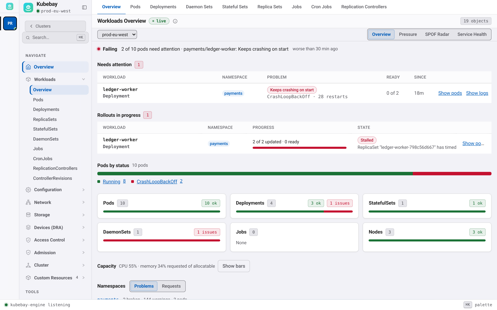
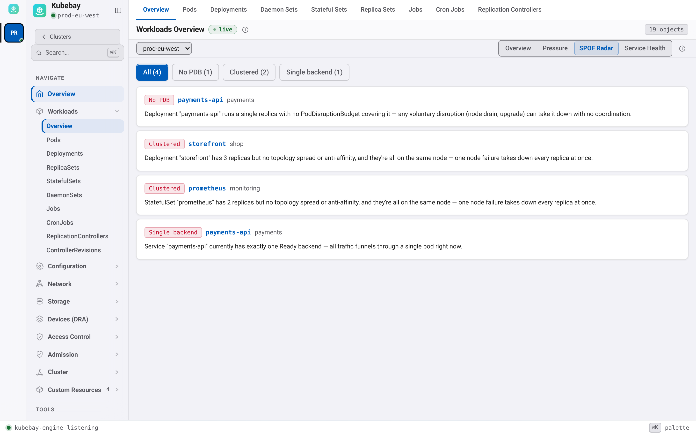
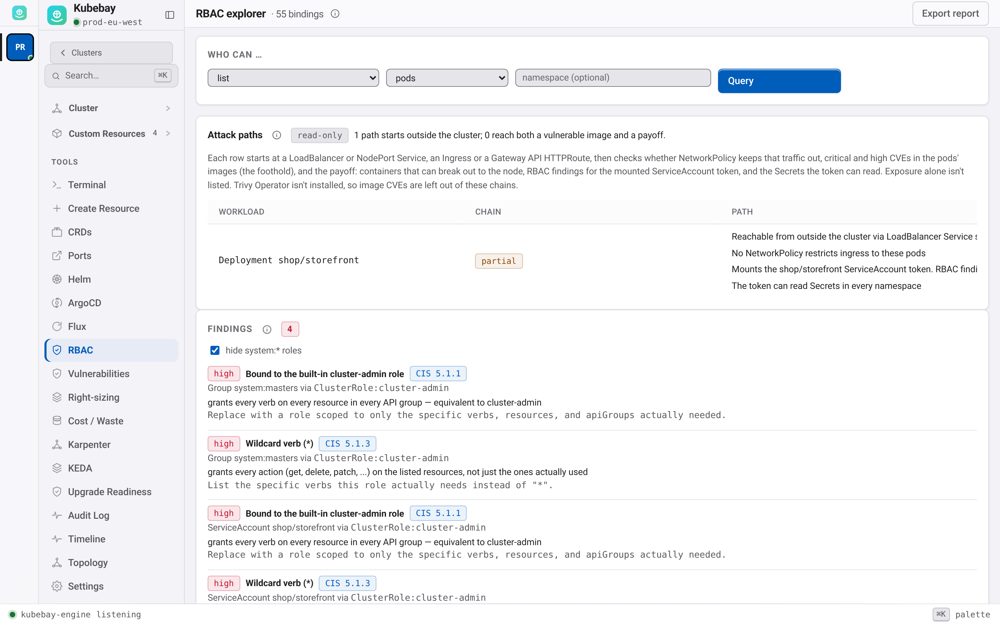

# Launch article draft

> Publish on kubebay.sardar.dev (canonical), then cross-post to dev.to, Hashnode and Medium with the canonical URL set. This is what you submit to KubeWeekly and Learnk8s. Newsletters link articles, not product pages. ~900 words. Rewrite in your own voice; keep the specifics.

---

# Why I built another Kubernetes UI, and what it does that the others don't

In January 2026 the official Kubernetes Dashboard was archived. By then Lens had gone proprietary and required an account even on its free tier, and OpenLens had stopped shipping. Freelens and Headlamp are good projects, and k9s is still my favourite thing in a terminal. But when a developer on my team asked "what's wrong with my deployment?", none of them answered the question. They showed me the cluster; I still had to work out what was wrong myself.

So I built **Kubebay**: a free, MIT-licensed, local-first Kubernetes IDE. This post covers what it is, how it works, and where it's still rough.

## Showing the cluster vs. telling you what's wrong



Kubebay's Overview opens on what's broken and *why*, in words ("1 of 2 available: keeps crashing on start"), and then on what's fragile even though it works today:

- **Single points of failure.** Deployments with one replica, no PodDisruptionBudget, or every replica on one node. These are the things that turn a routine node drain into an incident.
- **NetworkPolicy.** Which namespaces have no policy, a matrix of who can talk to whom, and a reachability check: "can this pod reach that Service?", answered from the policies. A builder dry-runs a policy before creating it.
- **Attack paths.** Chains that start where outside traffic lands (a LoadBalancer, an Ingress, an HTTPRoute) and follow it to a workload: is a NetworkPolicy keeping it out, do the pods run images with critical CVEs (a foothold), and does their ServiceAccount carry risky RBAC or a way out to the node (a payoff)? Exposure alone isn't listed; a chain needs a foothold or a payoff. Beside them: risky permissions, Secrets passed in environment variables, unused accounts.
- **Waste.** Requests compared with real usage, ranked, with a dry-run patch to right-size.
- **Upgrade readiness.** APIs your cluster serves that the next Kubernetes release removes.





There's more on top: Argo CD and Flux drift without logging into either, KEDA and Karpenter in plain words, and Trivy-Operator CVEs per workload.

## The everyday parts

Every kind and CRD is a live table, and none of them has a Refresh button. Logs, exec, a root shell on a node, port-forwards that don't need a terminal open, Helm (install, upgrade with a values diff, roll back), and YAML editing with a dry-run diff that refuses to overwrite a change someone else made in the meantime. ⌘K jumps anywhere.

## How it works

[Diagram: engine → informers → WebSocket → UI. Still to draw; see docs/ARCHITECTURE.md.]

One Go engine watches each cluster **once** using shared informers, lists metadata only where full objects aren't needed, and streams changes to the UI over a single multiplexed WebSocket. The same engine runs three ways:

1. inside a **Tauri** desktop app (not Electron);
2. as a **single binary** that serves the UI to your browser;
3. **in the cluster** as a Helm chart, with OIDC sign-in and per-user impersonation, so the UI honours each person's RBAC.

The performance budgets, ≤150 MB idle RAM and ≤1.5 s cold start, are measured in CI on every PR, and a PR over budget fails.

## Local-first, and I mean it

No account. No telemetry. Your kubeconfig never leaves your machine. The engine listens on 127.0.0.1 behind a per-session token. Every change you make through Kubebay is written to an audit log on your own disk. Every release artifact has a cosign signature and an SBOM.

The AI features are off until you turn them on. AI triage shows you exactly what it would send to a model and sends nothing until you click. The MCP server lets Claude or another client read only the clusters you pick, and any change it proposes waits for you to approve it.

## How it's built (honestly)

I'm one person, and I built Kubebay with heavy help from Claude Code. That makes some people nervous about a tool that touches production, and I understand why. What I can do is show the guardrails: tests are written before code; CI gates on Go and frontend tests, accessibility, theme contrast and performance budgets; and every page of the app has a docs page that CI checks exists. The rules are in the repo's `CLAUDE.md`. Read the code, and judge it.

## What's rough

- It's v0.7.
- Windows and Linux builds are tested in CI but not by hand yet.
- **[Until KB-03]** The macOS app isn't notarized yet. That's the next thing I'm fixing.
- It's one maintainer. That's why I'm writing this: I want people to use it and tell me what breaks.

## Try it

```
brew install rajasardar/tap/kubebay
```

Or download the desktop app or the single binary for macOS, Windows or Linux from the [releases page](https://github.com/RajaSardar/kubebay/releases/latest). Docs are at [kubebay.sardar.dev/docs](https://kubebay.sardar.dev/docs/).

Issues, ideas and "this broke on my cluster" reports are all welcome: [github.com/RajaSardar/kubebay](https://github.com/RajaSardar/kubebay).
